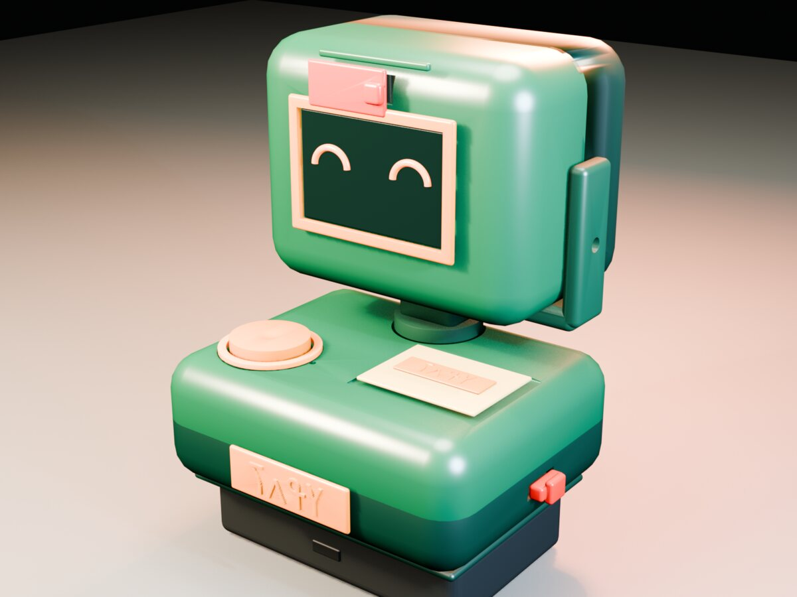
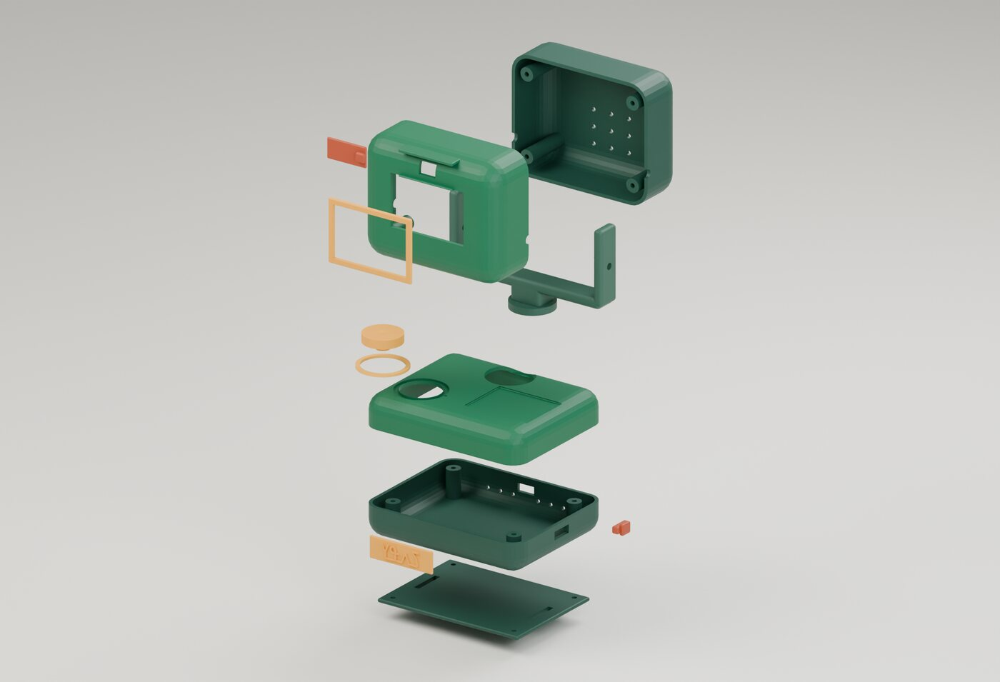
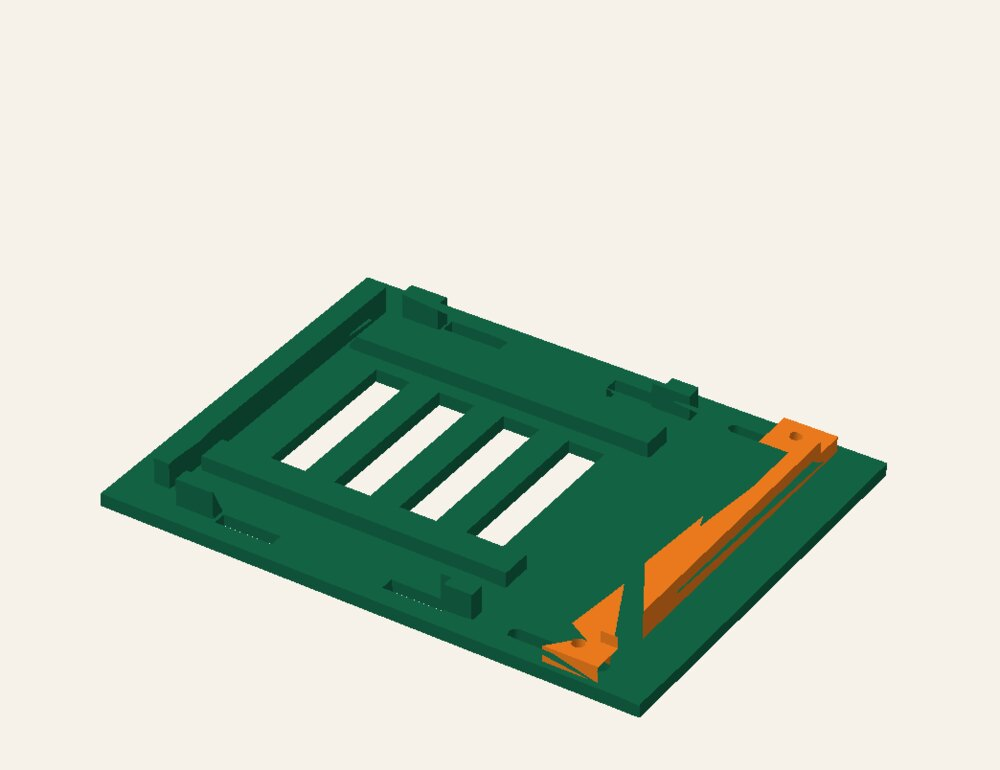
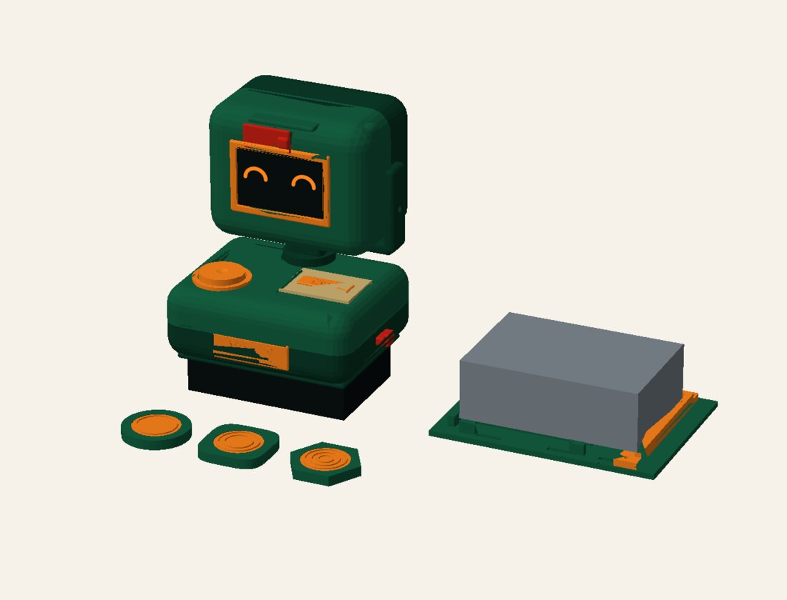

# Jeli device

A small printable device for learning Manding languages in N'Ko script. Tap a token, read the word on screen, hear the original speaker, record yourself and play it back.



**Status:** the body is designed and exported to STL, and a browser device-twin runs the lesson flow. The electronics are not wired yet and physical fit is still to be tested.

N'Ko is the alphabet Solomana Kanté created in 1949 for Manding languages. A tone mark can change the word, so the screen has to show marks clearly at lesson size.

## What's here

| Folder | What it is |
|---|---|
| `cad/` | OpenSCAD dimensional source and the Python generator (manifold3d) that builds the STLs |
| `stl/` | 15 printable parts, flat on Z=0, millimetres |
| `dock/` | Adjustable dock that holds a cased Raspberry Pi beside the body: generator, tests and STLs |
| `prototype/` | Browser device-twin, state machine, local API and ESP32-S3 firmware stubs |

## Body



124 × 114 × 150 mm assembled, 2.6 mm walls, 0.35 mm fit clearance. Every part fits a 220 × 220 mm bed.

| STL | Part |
|---|---|
| `head_front` | Front head shell with screen and camera windows |
| `head_rear` | Rear head shell with speaker grille |
| `display_bezel` | Display bezel |
| `camera_shutter` | Sliding camera shutter |
| `neck_yoke` | Neck yoke with pivot arms |
| `base_top` | Base top: talk button opening, token deck |
| `base_bottom` | Base bottom: connector and switch slots, vents |
| `talk_button`, `status_ring` | Talk button cap and status light ring |
| `privacy_slider` | Mic privacy slider |
| `nko_badge` | Nameplate in N'Ko |
| `pi_carrier`, `arducam_carrier`, `power_bank_sled` | Internal carriers |
| `fit_coupon` | Fit test coupon |

The SCAD files are the editable dimensional reference (`cad/jeli-config.scad`). `cad/tools/generate_meshes.py` is the fabrication source for the STLs. It stops if its dimensions drift from the SCAD config. `cad/tools/validate_stl.py` checks that each STL is a closed mesh.

```bash
cd cad
python3 -m venv .venv
.venv/bin/pip install -r requirements.txt
.venv/bin/python tools/generate_meshes.py   # writes cad/exports/ and cad/renders/
```

The badge needs a Noto Sans NKo font. Set `JELI_NKO_FONT` to its path if it isn't in the macOS default location.

## Dock



The body was sized for a bare Pi board. The dock lets the Pi stay in its case instead. A sliding end stop gives a 100 to 122 mm inside length, side guides leave an 88 mm gap, and straps hold the case down. All sizes are in `dock/design.json`.

It uses the same environment as `cad/`.

```bash
cd dock
../cad/.venv/bin/python build_dock.py                  # writes dock/stl/
../cad/.venv/bin/python -m unittest test_dock.py -v
```

The tests check that every part is a single closed solid, that the sliding stop clears the base across its full travel, that both bolt paths stay clear, and that the width coupon rejects a case that is too wide.



## Device-twin

```bash
cd prototype
./run.sh        # http://127.0.0.1:8787
python3 -m unittest discover -s tests -v
```

Pick a lesson card, hold the talk button to record, and play it back. The mic lock and camera shutter are modeled like the physical controls. Audio stays in the browser and is never uploaded or saved. The ESP32 firmware and the browser share one protocol (`prototype/protocol/JELI-PROTOCOL.md`), but the serial link between them isn't built yet.

## License

MIT
